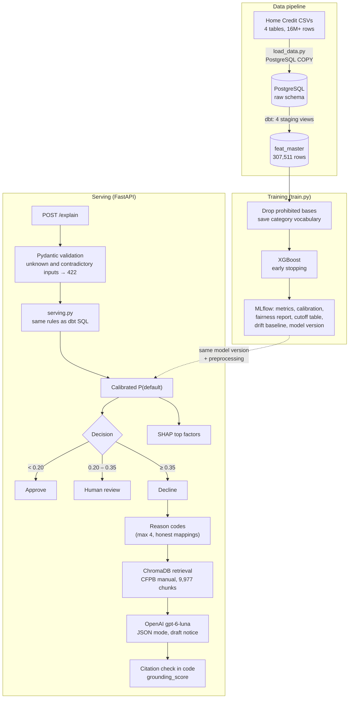

<div align="center">

# 🔍 LoanLens

### Explainable, fair-lending-aware credit risk scoring with regulation-grounded adverse action notices

[](https://github.com/MohammedAhmeduddin/loanlens/actions/workflows/ci.yml)


[**Live Demo**](https://huggingface.co/spaces/AhmeduddinMohammed/loanlens) ·
[**Portfolio**](https://ahmed-portfolio-blue.vercel.app) ·
[**LinkedIn**](https://linkedin.com/in/mohammed-ahmeduddin)

</div>

---

## Overview

When a lender declines a loan in the U.S., the Equal Credit Opportunity Act (Regulation B) and the Fair Credit
Reporting Act require it to tell the applicant the **specific, actual reasons**, and the decision must not rest on a
**prohibited basis** such as sex, marital status or age. A model that is accurate but cannot explain itself honestly
is not usable for lending.

**LoanLens** is an end-to-end system built around that requirement:

1. **Scores** an application with a calibrated XGBoost model (probability of default).
2. **Decides** approve / human review / decline using cutoffs chosen from a logged accuracy-and-fairness trade-off.
3. **Explains** the score with SHAP and maps the factors that raised risk to CFPB adverse-action reason codes.
4. **For declines only**, retrieves passages from the CFPB Supervision and Examination Manual and drafts an
   adverse action notice whose regulatory citations are **verified in code** against those passages.
5. **Audits fairness** on every training run, with sex and age kept out of the model and used only for the audit.

> **Scope.** A portfolio project on the public [Home Credit Default Risk](https://www.kaggle.com/c/home-credit-default-risk)
> dataset. Home Credit is not a U.S. lender, so ECOA / Regulation B and FCRA rules are applied as a realistic
> simulation, and generated notices are drafts for a compliance reviewer rather than final legal documents.

---

## Table of Contents

- [Key Results](#key-results)
- [Highlights](#highlights)
- [System Architecture](#system-architecture)
- [How It Works](#how-it-works)
  - [1. Data Pipeline](#1-data-pipeline)
  - [2. Credit Model](#2-credit-model)
  - [3. Decision Policy](#3-decision-policy)
  - [4. Fair Lending Controls](#4-fair-lending-controls)
  - [5. Explanations and Reason Codes](#5-explanations-and-reason-codes)
  - [6. Retrieval and Notice Drafting](#6-retrieval-and-notice-drafting)
  - [7. Training–Serving Parity](#7-trainingserving-parity)
  - [8. Drift Monitoring](#8-drift-monitoring)
- [Engineering Log](#engineering-log)
- [Live Demo](#live-demo)
- [API Reference](#api-reference)
- [Getting Started](#getting-started)
- [Configuration](#configuration)
- [Project Structure](#project-structure)
- [Testing and CI/CD](#testing-and-cicd)
- [Tech Stack](#tech-stack)
- [Limitations](#limitations)
- [Roadmap](#roadmap)
- [Author](#author)

---

## Key Results

All figures are from model **v4** on a held-out, stratified test set of **46,127 applicants**.

| Metric | Value |
|---|---|
| **Test AUC** | **0.770** (validation 0.772, train 0.854) |
| **Gini** | 0.541 |
| **Calibration** | mean predicted default **0.080** vs actual **0.081** |
| **Model inputs** | 71 features; **no sex, marital status or age** |
| **Auto-approved** (score < 0.20) | 91.3%, with a 6.0% default rate among approved |
| **Defaulters routed to review or decline** | 31.6% |
| **Fairness (four-fifths rule)** | impact ratio 0.948 by sex, 0.803 by age band, both passing |
| **Training data** | 307,511 applications · 13.6M installment payments · 1.7M bureau records |
| **Regulatory corpus** | 9,977 chunks from the CFPB Supervision and Examination Manual |
| **Quality** | 174 tests, 89.6% coverage, ruff lint and an 85% coverage gate in CI |

---

## Highlights

- **No prohibited-basis inputs.** Sex, marital status, age and an age-derived ratio are removed before training. The
  API rejects them, and the service refuses to load any model that uses them. Removing them cost **−0.004 AUC**.
- **Calibrated probabilities.** A score of 0.10 means roughly a 10% chance of default, so cutoffs mean what they say.
- **Reasons decided by the model, not the LLM.** Only risk-increasing factors with an honest reason-code mapping are
  cited, at most four.
- **Verified citations.** `grounding_score` is computed by checking every cited regulation against the retrieved
  passages; the LLM never grades itself.
- **Training–serving parity enforced by tests.** The API builds features with the same rules as the dbt SQL, and a
  test parses the SQL to catch drift between the two.
- **Fairness audit on every run.** Approval rates, calibration and good-borrower rejection rates by sex and age band
  are logged to MLflow with a cutoff trade-off table.

---

## System Architecture



---

## How It Works

### 1. Data Pipeline

| Stage | Tooling | Details |
|---|---|---|
| Load | `scripts/load_data.py` | Streams CSVs in 200K-row chunks and bulk-loads with PostgreSQL `COPY` (13.6M installment rows in ≈30 s). Reloads truncate instead of drop, so dependent dbt views survive. |
| Stage | dbt (`models/staging/`) | Four views clean and aggregate applications, bureau records, previous applications and installment payments per applicant. |
| Feature store | dbt (`models/features/feat_master.sql`) | Joins everything into one table of 307,511 applicants: ratios (debt-to-income, credit-to-annuity, income per person), bureau and payment-history aggregates, and record-presence flags. |

### 2. Credit Model

- **Algorithm:** XGBoost (`n_estimators=500`, `max_depth=6`, `learning_rate=0.05`, subsample 0.8, early stopping on
  validation AUC; best iteration 395).
- **Split:** stratified 70 / 15 / 15 → 215,257 train · 46,127 validation · 46,127 test.
- **No class re-weighting.** Weighting the 8% default class inflated every score about 4.6×. Training without it
  gives calibrated probabilities with the same ranking quality.
- **Tracked in MLflow:** AUC, KS, Gini, Brier score and mean predicted vs actual default rate per split, plus feature
  importance, the categorical vocabulary, the fairness report, the cutoff table and the drift baseline.

### 3. Decision Policy

Cutoffs on the calibrated probability of default, chosen from the trade-off table that every training run logs:

| Score | Decision | What happens |
|---|---|---|
| < 0.20 | **Approve** | No adverse action |
| 0.20 – 0.35 | **Human review** | Routed to an underwriter; no adverse action yet, so no notice |
| ≥ 0.35 | **Decline** | Reason codes, retrieval and a draft adverse action notice |

<details>
<summary><b>Cutoff trade-off table (test set, model v4)</b></summary>

| Approve below | Approval rate | Default rate among approved | Defaulters caught | Good borrowers not auto-approved | Impact ratio (sex) | Impact ratio (age) |
|---|---|---|---|---|---|---|
| 0.10 | 75.4% | 4.2% | 60.6% | 21.5% | 0.881 | 0.554 |
| 0.15 | 85.7% | 5.3% | 43.5% | 11.7% | 0.919 | 0.703 |
| **0.20** | **91.3%** | **6.0%** | **31.6%** | **6.7%** | **0.948** | **0.803** |
| 0.25 | 94.5% | 6.6% | 22.6% | 3.9% | 0.966 | 0.866 |
| 0.30 | 96.5% | 7.0% | 16.1% | 2.4% | 0.979 | 0.915 |

A lower cutoff stops more defaults but turns away more good borrowers, especially young ones. 0.20 is the lowest
cutoff at which both impact ratios pass the four-fifths screening rule.

</details>

### 4. Fair Lending Controls

| Control | Implementation |
|---|---|
| Prohibited bases excluded | `features.py` drops `code_gender`, `name_family_status`, `age_years` and `employed_to_age_ratio` before training. |
| Enforced at serving | The API schema forbids unknown fields (422), and the pipeline refuses a model whose features include a prohibited basis. |
| Disparate impact audit | Adverse impact ratio by sex and by age band (under 25, 25–39, 40–61, 62+; 62+ follows Regulation B's definition of elderly). |
| Error-rate audit | Per group: actual default rate, mean score, approval rate, good borrowers not auto-approved, defaulters caught. |

**Findings (test set, cutoff 0.20).** Impact ratios are 0.948 by sex and 0.803 by age band, both passing. The age gap
largely reflects real differences in default rates (11.9% under 25 vs 4.7% at 62+), but the model scores under-25s
slightly high (0.135 predicted vs 0.119 actual): 17.8% of under-25 applicants who repaid were not auto-approved,
versus 1.3% at 62+. This is documented rather than hidden, and borderline cases go to human review rather than
automatic decline.

### 5. Explanations and Reason Codes

SHAP `TreeExplainer` returns the top five factors for each applicant. Because the model predicts the probability of
**default**, a positive SHAP value means the factor **raised** risk.

A factor becomes a principal reason only if it raised risk **and** has an honest mapping to a CFPB reason code:

| Feature | Reason code |
|---|---|
| `ext_source_mean`, `ext_source_1/2/3` | A9 – Credit score |
| `late_payment_rate`, `bureau_overdue_count`, `bureau_max_overdue_days`, `total_delinquency_count` | A1 – Delinquent past or present credit obligations |
| `debt_to_income`, `credit_to_annuity`, `bureau_total_debt` | A6 – Debt-to-income ratio |
| `bureau_debt_to_credit`, `bureau_active_loans`, `prev_max_credit` | A3 – Too many accounts or too much credit |
| `employment_years` | A13 – Length of employment |
| `income_per_person` | A5 – Insufficient income |
| `prev_refused_count`, `amt_req_credit_bureau_year` | A7 – Number of recent inquiries |

Reasons are deduplicated by code and capped at four. Factors without a truthful mapping, such as education level,
are shown as "not a citable reason" and never appear on a notice.

### 6. Retrieval and Notice Drafting

| Step | Details |
|---|---|
| Corpus | CFPB Supervision and Examination Manual, split into 512-character chunks (50 overlap): 9,977 chunks |
| Embeddings | `sentence-transformers/all-MiniLM-L6-v2` (384-dim, CPU), stored in ChromaDB with cosine distance |
| Retrieval | Top 5 by cosine similarity, filtered at ≥ 0.30, top 3 kept. Runs for declines only. |
| Drafting | OpenAI `gpt-6-luna` in JSON mode. The prompt receives only the model's principal reasons and the retrieved passages, and must cite only that text. |
| Verification | `citations.py` extracts every cited regulation (CFR, U.S.C., § and "Section" formats) and checks each one against the retrieved passages. `grounding_score` = supported ÷ cited, and unsupported citations are returned and logged. |
| Robustness | Timeout and retries; retries without `temperature` if the model rejects it; a clear error on an empty reply. |

### 7. Training–Serving Parity

A model is only as good as the features it receives in production. LoanLens enforces parity in four places:

- **Feature construction:** `model/serving.py` mirrors `stg_application.sql` and `feat_master.sql`: the same ratios,
  "no record = 0" aggregates, record-presence flags and totals. `test_coalesce_list_matches_feat_master_sql` parses
  the SQL and fails if they diverge.
- **Categorical encoding:** each model version stores its vocabulary, and unknown or missing values become NaN,
  as in training.
- **Model version:** the API loads the model and its preprocessing from the same registered version, and
  `/model/info` reports that exact version.
- **Input coverage:** every `feat_master` column is either an API field or computed from them (tested), and
  contradictory histories are rejected.

### 8. Drift Monitoring

`train.py` saves a baseline sampled at random from the training split. `scripts/run_drift_check.py` computes the
Population Stability Index for ten key features between that baseline and a file of recent applications:

| PSI | Status |
|---|---|
| < 0.10 | Stable |
| 0.10 – 0.20 | Monitor |
| ≥ 0.20 | Severe: exit code 1, optional Slack alert |

A missing baseline is an error (exit code 2), never a silent pass.

---

## Engineering Log

The first version of this project had serious problems. I audited it end to end, and fixing what I found is most of
the work in this repository.

| # | Problem found | Impact | Fix |
|---|---|---|---|
| 1 | SHAP sign inverted | Every denial listed the applicant's **strengths** as reasons | Positive SHAP = higher default risk; regression test on a real trained model |
| 2 | Sex, marital status and age were model inputs | Prohibited bases under ECOA / Regulation B | Removed from training, rejected by the API, blocked at model load (−0.004 AUC) |
| 3 | Misleading reason mappings (age → "credit history", education → "credit score") | Notices stated false reasons | Removed; unmapped factors are never cited |
| 4 | Class weighting inflated scores ~4.6× | 46% of applicants not approved; 79% of good borrowers under 25 turned away | Calibrated model; cutoffs from a logged trade-off table |
| 5 | Categories encoded with `hash() % 100` at serving | Encodings changed on every restart | Vocabulary saved per model version |
| 6 | API left 25 aggregates and several ratios missing | Out-of-distribution inputs dominated every score | `serving.py` mirrors the dbt SQL, enforced by tests |
| 7 | Only 500K of 13.6M installment rows loaded | 76.5% of applicants had no payment history | Full load with `COPY`; AUC 0.766 → 0.770 |
| 8 | The LLM chose the reasons and graded its own "grounding" | Unverifiable statements on a legal notice | Reasons from the model; citations verified in code |
| 9 | Drift job compared the training data with itself | It could never detect drift | Baseline from the training split; new data compared against it |
| 10 | Unknown API fields silently dropped | Inputs such as `age_years` were ignored without error | Unknown fields rejected with 422 |

---

## Live Demo

**[huggingface.co/spaces/AhmeduddinMohammed/loanlens](https://huggingface.co/spaces/AhmeduddinMohammed/loanlens)**

The public demo has no live API. It shows the stored output of a real pipeline run (model v4, `gpt-6-luna`) for
three sample applicants, generated by `scripts/generate_demo_samples.py`. If you change the inputs, it says that live
scoring needs the API instead of showing a canned result.

| Sample | P(default) | Decision | Principal reasons |
|---|---|---|---|
| High debt, late payments | 0.405 | 🔴 Decline | Credit score · late installment payments · credit utilization · credit amount vs payment capacity |
| Average borrower | 0.115 | 🟢 Approve | none |
| Stable borrower | 0.010 | 🟢 Approve | none |

All samples assume a stated, typical application and credit history (shown on the page), so the model never
receives inputs it did not see in training.

---

## API Reference

Interactive docs at `http://localhost:8000/docs` when the API is running.

| Method | Endpoint | Description |
|---|---|---|
| `GET` | `/health` | Model loaded and indexed chunk count |
| `POST` | `/score` | Probability of default and decision |
| `POST` | `/explain` | Score, SHAP factors and, for declines, reason codes, retrieved passages, draft notice and citation check |
| `GET` | `/model/info` | Metrics and cutoffs of the exact model version being served |

<details>
<summary><b>Example: <code>POST /explain</code> (the high-risk demo applicant)</b></summary>

**Request** (abridged; the demo also sends the typical-application fields listed in `dashboard/samples.py`,
and the response below is from that full request)

```json
{
  "amt_income_total": 24000,
  "amt_credit": 380000,
  "amt_annuity": 19000,
  "amt_goods_price": 380000,
  "name_contract_type": "Cash loans",
  "name_income_type": "Working",
  "employment_years": 0.5,
  "ext_source_2": 0.12,
  "bureau_loan_count": 5,
  "bureau_overdue_count": 4,
  "bureau_debt_to_credit": 0.92,
  "prev_app_count": 3,
  "prev_refused_count": 3,
  "instalment_count": 24,
  "late_payment_rate": 0.6
}
```

**Response** (shortened)

```json
{
  "probability": 0.405,
  "decision": "decline",
  "shap_factors": [
    {"rank": 1, "feature": "ext_source_mean", "direction": "increases_risk",
     "label": "External credit score assessment", "cfpb_code": "A9 - Credit score"},
    {"rank": 2, "feature": "late_payment_rate", "direction": "increases_risk",
     "label": "History of late installment payments",
     "cfpb_code": "A1 - Delinquent past or present credit obligations"}
  ],
  "adverse_action_codes": [
    "A9 - Credit score",
    "A1 - Delinquent past or present credit obligations",
    "A3 - Too many accounts or too much credit",
    "A6 - Debt-to-income ratio"
  ],
  "adverse_action_notice": "We regret to inform you that your application for credit has been declined. The principal reasons for this decision are: External credit score assessment; History of late installment payments; High credit utilization across accounts; and Credit amount relative to payment capacity. This decision was based in whole or in part on information in a consumer report. You have the right to obtain a free copy of the credit report used and to dispute its accuracy.",
  "citation_check": {
    "cited": ["15 U.S.C. 1681m", "Section 615(a)"],
    "supported": ["15 U.S.C. 1681m", "Section 615(a)"],
    "unsupported": [],
    "grounding_score": 1.0
  }
}
```

</details>

<details>
<summary><b>Validation errors (422)</b></summary>

| Request | Error |
|---|---|
| Contains `age_years`, `code_gender` or any unknown field | `Extra inputs are not permitted` |
| `bureau_overdue_count` > `bureau_loan_count` | `bureau_overdue_count cannot exceed bureau_loan_count` |
| `prev_refused_count` > `prev_app_count` | `prev_refused_count cannot exceed prev_app_count` |
| `late_payment_rate` > 0 with no `instalment_count` | `late_payment_rate > 0 requires instalment_count > 0` |
| A `has_*_history` flag of 0 with a positive count | `... contradicts ...` |

</details>

---

## Getting Started

### Prerequisites

- Python 3.11, Docker Desktop
- [Home Credit Default Risk](https://www.kaggle.com/c/home-credit-default-risk/data) CSVs in `data/raw/`
  (`application_train.csv`, `bureau.csv`, `previous_application.csv`, `installments_payments.csv`)
- An OpenAI API key (only needed for drafting notices; scoring and SHAP work without it)

### Setup

```bash
# 1. Clone and install
git clone https://github.com/MohammedAhmeduddin/loanlens && cd loanlens
python -m venv .venv && source .venv/bin/activate
pip install -e ".[dev]"
cp .env.example .env            # set POSTGRES_PASSWORD and OPENAI_API_KEY

# 2. Start PostgreSQL
docker compose up -d postgres

# 3. Load the raw data and build the feature store
python scripts/load_data.py
export POSTGRES_PASSWORD=$(grep '^POSTGRES_PASSWORD=' .env | cut -d= -f2-)
(cd dbt/loanlens && dbt run --profiles-dir .)

# 4. Train (logs metrics, fairness report, cutoff table and drift baseline to ./mlflow/mlruns)
python src/loanlens/model/train.py

# 5. Index the CFPB manual into ChromaDB
python src/loanlens/rag/ingest.py

# 6. Run the API and the dashboard
uvicorn src.loanlens.api.main:app --port 8000      # http://localhost:8000/docs
API_URL=http://localhost:8000 python src/loanlens/dashboard/app.py   # http://localhost:7860
```

### Useful Commands

| Command | Purpose |
|---|---|
| `pytest -q` | Run the 174 tests (OpenAI, MLflow and ChromaDB are mocked) |
| `ruff check src tests scripts` | Lint |
| `python scripts/load_data.py --tables installments_payments` | Reload a single table |
| `python scripts/generate_demo_samples.py` | Regenerate the dashboard's stored demo results from the real pipeline |
| `python scripts/run_drift_check.py --current recent.csv` | PSI drift check against the training baseline |
| `mlflow ui --backend-store-uri ./mlflow/mlruns --port 5001` | Browse training runs |

---

## Configuration

Set in `.env` (see `.env.example`). Settings are loaded with `pydantic-settings`, so environment variables take
precedence.

| Variable | Default | Description |
|---|---|---|
| `POSTGRES_PASSWORD` | *required* | Feature store password |
| `OPENAI_API_KEY` | *required* | Used only to draft notices for declines |
| `OPENAI_MODEL` | `gpt-6-luna` | Notice drafting model (`gpt-4o-mini` shuts down 2027-01-14) |
| `OPENAI_MAX_COMPLETION_TOKENS` | `4000` | Includes reasoning tokens for reasoning models |
| `OPENAI_TIMEOUT_SECONDS` / `OPENAI_MAX_RETRIES` | `60` / `2` | API call limits |
| `REVIEW_THRESHOLD` | `0.20` | Approve below this probability of default |
| `DECLINE_THRESHOLD` | `0.35` | Decline at or above this probability of default |
| `PSI_MODERATE_THRESHOLD` / `PSI_SEVERE_THRESHOLD` | `0.10` / `0.20` | Drift alert levels |
| `MLFLOW_TRACKING_URI` | `./mlflow/mlruns` | MLflow run store |
| `CHROMA_PERSIST_DIR` | `./chroma_db` | Vector store location |
| `SLACK_WEBHOOK_URL` | empty | Optional drift alerts |

---

## Project Structure

```
loanlens/
├── src/loanlens/
│   ├── api/
│   │   ├── main.py              # FastAPI app: /health, /score, /explain, /model/info
│   │   └── schemas.py           # Request/response models; rejects unknown and contradictory input
│   ├── model/
│   │   ├── features.py          # Prohibited-basis list, categorical vocabulary and encoding
│   │   ├── serving.py           # Builds features exactly like the dbt SQL
│   │   ├── data_loader.py       # Loads feat_master and preprocesses for training
│   │   ├── train.py             # XGBoost training, calibration, fairness, cutoff table, drift baseline
│   │   ├── evaluate.py          # AUC, KS, Gini, Brier, calibration
│   │   ├── fairness.py          # Adverse impact ratios, per-group outcomes, cutoff trade-offs
│   │   ├── explain.py           # SHAP factors, reason-code mapping, model and artifact loading
│   │   └── registry.py          # MLflow model version info
│   ├── rag/
│   │   ├── ingest.py            # Chunk and index the CFPB manual into ChromaDB
│   │   ├── retriever.py         # Cosine similarity retrieval with a minimum-similarity filter
│   │   ├── generator.py         # Notice drafting (OpenAI, JSON mode)
│   │   ├── citations.py         # Citation extraction and verification
│   │   └── pipeline.py          # Score → decide → explain → (declines) retrieve, draft, verify
│   ├── monitoring/
│   │   ├── drift.py             # PSI and training baseline
│   │   └── alerts.py            # Optional Slack alerts
│   ├── dashboard/
│   │   ├── app.py               # Gradio dashboard
│   │   ├── samples.py           # Demo samples and result formatting
│   │   └── demo_samples.json    # Stored output of a real pipeline run
│   └── config.py                # Settings (pydantic-settings)
├── dbt/loanlens/models/
│   ├── staging/                 # stg_application, stg_bureau, stg_previous_application, stg_installments
│   └── features/                # feat_master: one row per applicant
├── scripts/
│   ├── load_data.py             # Bulk CSV → PostgreSQL loader (COPY)
│   ├── generate_demo_samples.py # Regenerate dashboard demo results
│   └── run_drift_check.py       # PSI check against the training baseline
├── tests/                       # 174 tests (see below)
├── data/regulations/            # CFPB Supervision and Examination Manual (PDF)
├── .github/workflows/ci.yml     # Lint + tests with 85% coverage gate
├── docker-compose.yml           # PostgreSQL 16 (+ pgAdmin for local use)
├── app.py                       # Hugging Face Spaces entry point
└── pyproject.toml               # Dependencies, pytest and ruff configuration
```

---

## Testing and CI/CD

All external services (OpenAI, MLflow, ChromaDB, PostgreSQL) are mocked, so the suite runs offline in seconds.
Several tests train a small real XGBoost model to verify behavior end to end.

| Test file | Tests | Covers |
|---|---|---|
| `test_api.py` | 32 | Endpoints, request validation, rejected prohibited and unknown fields, no leaked error details |
| `test_fair_lending.py` | 23 | Prohibited features excluded, SHAP direction on a real model, honest reasons, fairness metrics, calibration |
| `test_pipeline.py` | 21 | Decisions and cutoff boundaries, notices and codes only for declines, model version consistency |
| `test_train_and_ingest.py` | 19 | Training and MLflow logging, ChromaDB ingestion, 503 when no model is loaded |
| `test_serving_features.py` | 17 | Parity with the dbt SQL, contradictory input rejection, demo input completeness |
| `test_model.py` | 16 | Data loading, metrics, SHAP factor extraction |
| `test_monitoring.py` | 16 | PSI, drift detection, baseline sampling, drift script exit codes, Slack alerts |
| `test_citations.py` | 13 | Citation extraction and verification, model-decided reasons, OpenAI call handling |
| `test_rag.py` | 12 | Generator parsing, retriever filtering, ingestion |
| `test_dashboard_samples.py` | 5 | Demo formatting; no notices for approvals or reviews |
| **Total** | **174** | **89.6% line coverage** |

**GitHub Actions** (`.github/workflows/ci.yml`) runs on every push and pull request to `main`:

1. Install the package with dev dependencies (Python 3.11)
2. `ruff check src tests scripts` (version pinned)
3. `pytest` with the 85% coverage gate from `.coveragerc`
4. Upload the coverage report as an artifact

---

## Tech Stack

| Layer | Technology |
|---|---|
| Data | PostgreSQL 16 · dbt · pandas |
| Modeling | XGBoost · scikit-learn · SHAP |
| Experiment tracking | MLflow (model registry, artifacts) |
| Retrieval | ChromaDB · sentence-transformers (all-MiniLM-L6-v2) · LangChain text splitters |
| LLM | OpenAI `gpt-6-luna` (JSON mode) |
| Serving | FastAPI · Pydantic v2 · Uvicorn |
| Dashboard | Gradio (Hugging Face Spaces) |
| Quality | pytest · pytest-cov · ruff · GitHub Actions |
| Infrastructure | Docker Compose |

---

## Limitations

- **U.S. rules simulated on non-U.S. data.** Reason codes and notices follow ECOA / Regulation B and FCRA patterns.
  The notice is a draft: it lacks the creditor's details, the ECOA anti-discrimination statement and the consumer
  reporting agency's contact details.
- **Proxy risk.** Education level and income type are legal inputs but can correlate with protected traits that this
  dataset cannot audit (race, national origin). Sex and age are audited; under-25 applicants are scored slightly
  high.
- **Retrieval adds limited variety.** The query is built from reason labels, so declines retrieve similar passages
  about adverse-action requirements. Its role is to ground citations, not to find borrower-specific facts.
- **Overfitting gap.** Train AUC 0.854 vs test 0.770, with no hyperparameter search yet.
- **No production traffic.** Drift monitoring runs on a file you provide; there is no live request log.
- **Demo service.** The API has no authentication or rate limiting.

---

## Roadmap

- [ ] Hyperparameter search (Optuna) to narrow the train–test gap
- [ ] Per-group calibration adjustment for under-25 applicants, re-checked against the fairness report
- [ ] Complete notice template (creditor details, ECOA statement, credit bureau disclosure)
- [ ] Log scored requests to enable real drift monitoring
- [ ] Retrieval evaluation (precision of retrieved passages for each reason code)
- [ ] Deploy the API with authentication behind the dashboard

---

## Author

**Mohammed Ahmeduddin**: Machine Learning Engineer

[GitHub](https://github.com/MohammedAhmeduddin) · [LinkedIn](https://linkedin.com/in/mohammed-ahmeduddin) ·
[Portfolio](https://ahmed-portfolio-blue.vercel.app)

<sub>Built on the public Home Credit Default Risk dataset. Not affiliated with Home Credit, the CFPB or OpenAI.</sub>
